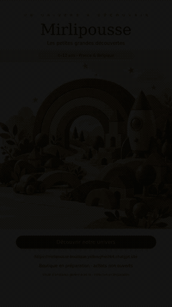

<p align="center">
  
</p>

<p align="center">
  <strong>Des idées pour jouer, créer et grandir, de 0 à 12 ans.</strong><br>
  Jouets et accessoires pour les familles en France et en Belgique.
</p>

<p align="center">
  <a href="https://mirlipousse.onrender.com"><strong>🌱 Ouvrir Mini &amp; Merveilles</strong></a>
  &nbsp; · &nbsp;
  <a href="https://mirlipousse.onrender.com/medias"><strong>▶ Découvrir les médias</strong></a>
  &nbsp; · &nbsp;
  <a href="#le-projet"><strong>↓ Le projet</strong></a>
</p>

---

<p align="center">
  
  <br>
  <sub>Un aperçu animé de 6 secondes. <a href="https://mirlipousse.onrender.com/medias">Voir la vidéo et télécharger les médias</a>.</sub>
</p>

<a id="le-projet"></a>

## Un petit univers à explorer

Mini &amp; Merveilles prépare une boutique de jouets et d’accessoires pour enfants. Son univers associe papier crème, bois doux, vert sauge et touches de terracotta, avec des animations légères et une navigation pensée pour le téléphone.

| Découvrir | Imaginer | Grandir |
| :--- | :--- | :--- |
| Des idées classées par âge, de 0 à 12 ans. | Des univers de jeu, de création et d’aventure. | Des guides simples pour aider les familles à choisir. |

La vitrine présente **30 références fournisseur réelles et leurs photos CJ**, des collections, deux guides et une galerie de **13 médias de présentation**, dont une vidéo. Les anciennes illustrations restent uniquement dans cette galerie, clairement identifiées.

> **Catalogue en préparation : les achats sont fermés.** Les photos des fiches viennent du fournisseur. Les âges, la conformité enfant, les documents fabricant et les conditions de livraison restent à qualifier. Les tarifs EUR affichés sont indicatifs et hors livraison : aucun prix encaissable n’est qualifié ; le panier reste sans paiement.

## Ce que l’on peut déjà explorer

- Parcourir les collections et les idées selon l’âge.
- Chercher et trier les 30 produits dans 7 catégories, consulter leurs photos, leur variante documentée et leur tarif EUR indicatif. Les âges non documentés restent « à confirmer ».
- Conserver des favoris et un panier de démonstration sur son appareil.
- Lire les guides et découvrir les visuels, la vidéo et leurs téléchargements.
- Profiter du design responsive et des animations du site.
- Donner un avis sur le site : note et commentaire sont conservés côté serveur, puis publiés après modération. Le pseudonyme est facultatif ; aucun achat vérifié n’est prétendu.

Le SIRET communiqué est **988 178 257 00016**. Les paiements restent fermés pendant la qualification commerciale.

## Avant les premières commandes

| Étape | État réel |
| :--- | :--- |
| Vitrine et médias | Présentés dans ce dépôt. |
| Paiement SumUp | Compte relié · paiements fermés. Connexion API vérifiée ; encaissement réel et parcours complet encore à qualifier. |
| Fournisseur CJdropshipping | Authentification et paramètres réels vérifiés ; catalogue, détail d’un produit et stock fournisseur positif contrôlés. Service privé authentifié sur Render. |
| Produits, stocks et livraison | Références et photos importées. Stocks observés à la collecte, sans garantie de livraison en France/Belgique ; frais, taxes, conformité et délais à vérifier. |
| Parcours de commande | Panier, estimation pays/standard, formulaire futur, reprise et suivi préparés. Ventes fermées ; aucune commande ni paiement réel qualifié par cette vitrine. |

## Des parcours prêts à qualifier

Sept catégories, recherche, tri et tarifs indicatifs couvrent les 30 références. Les anciens favoris et paniers gardent leurs identifiants et leurs quantités. La livraison prévue est standard à domicile en France et en Belgique. Mondial Relay est mis en attente ; aucun choix de point relais n’est proposé. Les frais et délais seront confirmés avant paiement.

Les coordonnées ne sont demandées que si le serveur et le devis ouvrent réellement le parcours. Le téléphone de livraison est alors obligatoire. Aucune adresse n’est conservée dans le navigateur ; seuls les accès privés de reprise sont enregistrés. Les états de paiement et d’annulation sont vérifiés côté serveur, jamais déduits du retour navigateur.

Les sources frontend maintenables et leurs tests se trouvent dans `sources/parcours-client/`, sans secret ni backend Sites copié.

## Une vitrine légère à publier

Ce dépôt contient l’export statique de la vitrine : **29 pages : 26 pages vitrine dont documents légaux, avis, contact et suivi, 2 saisies chiffrées privées et 1 page de connexion Mondial Relay en attente**, les ressources du site et ses médias. Il est préparé pour un hébergement statique sur Render.

```text
public/                  Pages, styles, scripts et médias du site
docs/                    Bannière et aperçu animé du README
scripts/verifier-paquet.py
verification/EXPORT.json Empreintes des fichiers publics
render.yaml              Configuration de publication statique
```

La vitrine publique ne contient aucune clé CJ. Le service fournisseur (`server/`) reste protégé par authentification et n’exécute aucune commande ni paiement. La connexion API SumUp est vérifiée ; les paiements restent fermés. Aucun encaissement réel ni parcours complet n’est encore qualifié. Les avis utilisent un service durable distinct : aucun avis global n’est simulé dans le stockage local.

Le paquet se vérifie avant publication avec :

```sh
python3 scripts/verifier-paquet.py
```

Le contenu publié est uniquement `public/`. Les fichiers du README restent dans le dépôt. Les sauvegardes de code et les vérifications de livraison sont gérées séparément ; aucune donnée client ni clé privée n’a sa place ici.

<details>
<summary><strong>À propos de l’animation de cette page</strong></summary>

Le README utilise un GIF léger, extrait du teaser existant. GitHub ne lance pas les animations JavaScript ou les transitions CSS d’un site dans un README : l’aperçu GIF présente donc le mouvement, tandis que la vitrine propose l’expérience interactive complète.

Le teaser et les visuels restent des supports de présentation. Les éventuelles adresses incrustées dans leurs images ne remplacent pas les liens de navigation affichés dans ce README.

</details>

---

<p align="center">
  <strong>Mini &amp; Merveilles</strong><br>
  <em>Les petites grandes découvertes.</em><br><br>
  <sub>Créé par <strong>Bach Gaëlle</strong></sub>
</p>

## Informations légales accessibles

[Informations légales](https://mirlipousse.onrender.com/informations-legales/) · [CGV de préparation](https://mirlipousse.onrender.com/cgv/) · [Rétractation](https://mirlipousse.onrender.com/retractation/) · [Garanties](https://mirlipousse.onrender.com/garanties/) · [Confidentialité](https://mirlipousse.onrender.com/confidentialite/)

Les documents sont disponibles sans compte, avec formulaire type et CGV téléchargeables en texte. Les retours sont prévus à Talairan. La franchise en base de TVA est déclarée par la vendeuse ; Médiation CMFM est désigné comme médiateur de la consommation, tandis que le traitement des importations reste à finaliser ; les pages ne certifient pas une conformité juridique complète et n’ouvrent pas les ventes. Le traitement prévu est manuel : vérification du paiement SumUp puis règlement du fournisseur par le vendeur. Aucun transfert automatique SumUp vers CJ.

Les contenus se maintiennent dans `content/legal-pages.json` et sont rendus par `python3 scripts/generer-pages-legales.py`. Le pied de page React reste dans les sources frontend. Chaque changement public doit être requalifié et la carte complète `verification/EXPORT.json` recalculée avant publication.
